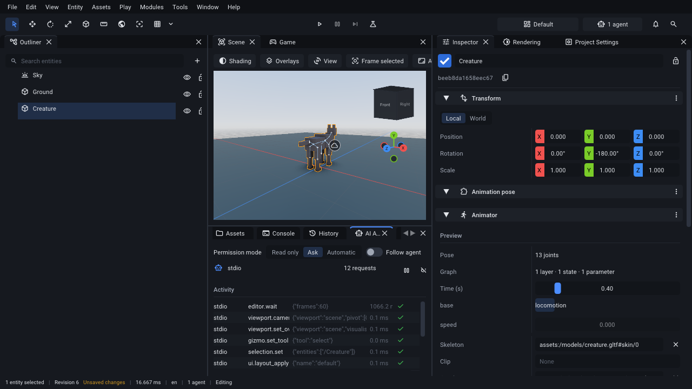

# Animation

Characters, creatures and machines move with bones: a skinned mesh follows the joints of a skeleton, and a
clip moves the joints over time. illusion imports skins and clips from glTF, poses them on the Job System
and skins the meshes on the GPU ([ADR 0059](../architecture/decisions.md)).

## Importing a rigged glTF model

`loadGltf()` reads the skins and animations of a glTF file into its `ModelData`, next to the meshes:

- `ModelData::skins` holds one `Skeleton` per glTF skin, of up to `kMaxJoints` (1,024) joints. Joints are
  sorted so that parents come before their children; each keeps its name, parent, rest pose and inverse
  bind matrix.
- `ModelData::animations` holds one `AnimationClip` per glTF animation. A channel moves the translation,
  rotation or scale of a joint **by name** with `Step`, `Linear` or `CubicSpline` keys, so a clip plays on
  every skeleton whose joints have those names. Clips without a name are called `animation<N>`; repeated
  names get `.2`, `.3`, ...
- A skinned mesh keeps its vertices and gets `MeshData::skin`, a parallel stream of `SkinVertex` (four
  joints and four weights per vertex, 16 bytes), plus the bounds each joint moves (`jointBounds`). Vertices
  with more than four influences keep the four largest, renormalized.

Morph targets, channels on nodes that are not joints and invalid skin data are skipped with a log line;
the mesh is then drawn rigid.

## Asset paths

Saved Components refer to the parts of a model by asset path fragments:

| Fragment | Refers to |
| --- | --- |
| `model.glb#mesh/N` | Mesh `N` (a `MeshRenderer`) |
| `model.glb#skin/N` | Skeleton `N` (`AssetKind::Skeleton`) |
| `model.glb#animation/<name>` | The clip called `<name>` (`AssetKind::AnimationClip`) |

## The Animator

A skinned mesh moves with the saved Component `Animator`, on the Entity of its `MeshRenderer`. An
`AnimationWorld` per World keeps the poses outside the ECS and adds the runtime Component `AnimationPose`
(the pose's slot, its joint count and its world bounds):

Headers: `<illusion/animation/AnimationComponents.hpp>`, `<illusion/animation/AnimationWorld.hpp>`

```cpp
illusion::AnimationWorld animation(world, streamer);
const illusion::Entity hero = world.create(
    illusion::Transform{}, illusion::MeshRenderer{.mesh = illusion::AssetRef("game:/hero.glb#mesh/0")},
    illusion::Animator{.skeleton = illusion::AssetRef("game:/hero.glb#skin/0"),
                       .clip = illusion::AssetRef("game:/hero.glb#animation/Walk")});

// Every frame, after game code and before physics:
animation.update(deltaSeconds, &jobs, true);
const illusion::AnimationPose& pose = world.get<illusion::AnimationPose>(hero);
const std::span<const illusion::SkinMatrix> skin = animation.skinMatrices(pose.slot);
```

| Field | Meaning |
| --- | --- |
| `skeleton` | The skeleton, `model.glb#skin/N`; it must be the skin of the mesh |
| `clip` | The clip, `model.glb#animation/<name>`; none shows the rest pose |
| `graph` | An [animation graph](#animation-graphs) (`.animgraph`) that drives the Animator instead of `clip` |
| `speed` | Playback rate; negative plays backwards |
| `time` | Seconds into the clip |
| `loop` | Wrap at the clip's end; otherwise hold the last pose |
| `playing` | Advance `time` while the game runs |

- Every field is saved, so scenes and [saved games](saved-games.md) keep where a clip was.
- With `advance` true (Play mode and the player; `GameSession` passes it while started), `update()` adds
  `speed` times the seconds to `time`, wrapped into the clip when `loop` is on; otherwise `time` stops at
  the clip's end (or its start when playing backwards) and `playing` turns false.
- Each model file loads once through the `AssetStreamer`; its skeletons, clips and the joint bounds of its
  meshes are shared by every Animator, and a clip is bound to a skeleton once. The poses are sampled and
  composed in parallel on the Job System into one contiguous buffer of skin matrices;
  `previousSkinMatrices()` holds the update before (equal to the current ones on a pose's first update),
  for motion vectors. `AnimationPose::bounds` is the skinned mesh's bounds in world space.
- The pose waits while its model loads (`jointCount` is 0). A skeleton that does not fit the mesh (another
  skin, another joint count, or a rigid mesh) is reported once and gets no pose; the mesh is drawn in its
  bind pose. Entities with the `Inactive` tag keep their pose and `time`.
- Reloading a model file (`AssetStreamer::reload()`) binds its Animators again; a reload that fails keeps
  the previous data. A steady update allocates nothing.

## Playback and scrubbing in the editor

Add an `Animator` to the Entity of a skinned `MeshRenderer` in the Inspector and set its `skeleton` and
`clip`. Outside Play mode the editor poses the edit World at the saved `time` without advancing it, so
dragging `time` in the Inspector scrubs the clip in the Scene view. In Play mode the session's
`AnimationWorld` advances `time` of every playing Animator; Stop returns to the saved values. The
Animator's card in the Inspector also has a timeline scrubber ([In the Inspector](#in-the-inspector)). The showcase
project's `Column` plays its clip `sway` this way ([Showcase project](editor/showcase.md)).

## From the editor and agents

The `animation.*` [Editor commands](../reference/editor-commands.md) let people and agents look inside animation,
scrub it and drive it:

| Command | What it does |
| --- | --- |
| `animation.list` | The skins and clips of a model (`path`): for each skin the reference for `Animator::skeleton` and its joint count, for each clip the reference for `Animator::clip`, its duration in seconds, its channel count and the skin it was authored on (`source`), and for each skin whether its rig is `humanoid` |
| `animation.status` | The Animators of the scene (`entity`, or every Animator up to 100): the saved fields and, in a play session, whether the pose exists, whether the graph has loaded, per layer the current state, its normalized time and the state a running transition fades out, every parameter with its value, and the state events of the last update |
| `animation.set_parameter` | Sets a `Float`, `Int` or `Bool` parameter of the graph of an Animator in the play session; the value must fit the parameter's type |
| `animation.trigger` | Sets a `Trigger` of the graph in the play session |
| `animation.scrub` | Sets `Animator::time` of an Animator of the open scene: an undoable edit of the saved Component, shown at once in the Scene view |
| `animation.validate` | Parses an `.animgraph` or `.ragdoll` file. The result says `valid`, counts `parameters`, `layers` and `states` (or `parts`), and for a mistake gives `error` and its JSON `errorPath`, e.g. `layers[0].states[2].motion`. A file that does not parse is a result, not a failed command |
| `animation.rig` | The rig map of one skin (`path`, `skin`): for every joint its bone, its translation mode (`Skeleton`, `Scaled` or `Animation`) and whether the model's sidecar overrides it, `humanoid`, the `missing` required humanoid bones and the `warnings` generation gave |
| `animation.map_joint` | Writes one override of a skin's rig map (`joint`, `bone` or `translation`, or both; `""` unmaps the joint) into the model's `.import.json` sidecar and reloads the model. Undoable, like `asset.set_import_settings`, which it goes through |
| `animation.retarget` | How a `clip` plays on a `skeleton`: `retargeted`, or bound by name with the `reason` (`SameSkeleton`, `NoSkeleton`, `NoRig` or `NoPairs`), the channels that found a joint, the `unpaired` ones, the joints of the skeleton that hold the reference pose and the hips `heightRatio` |

```json
{"call": "animation.list", "params": {"path": "assets:/models/column.gltf"}}
{"call": "animation.validate", "params": {"path": "assets:/animations/column.animgraph"}}
{"call": "animation.scrub", "params": {"entity": "/Column", "time": 0.6}}
{"call": "animation.status", "params": {"entity": "/Column"}}
{"call": "animation.set_parameter", "params": {"entity": "/Column", "name": "lean", "value": 0.8}}
{"call": "animation.trigger", "params": {"entity": "/Column", "name": "bow"}}
```

`animation.set_parameter` and `animation.trigger` need a running session (`play.start`); they act on the play
World and are not undoable, because a parameter is runtime state. The graph uses a written value at the next
update, so `play.step` after a command shows its effect in `animation.status`. `animation.scrub` always acts on
the edit World, also while the game plays, and the game starts from the time it left. `animation.status` in the
edit World is `live` when a Scene view poses it: then it also reports `posed`, `joints` and the loaded graph's
layers and parameters at the saved time; without a viewport (a headless editor without a GPU) `live` is false
and `note` says so. Events and running states exist in the play session. Every invalid param is reported with its JSON Pointer (`/name` for a parameter the
graph does not have, with suggestions, `/value` for a value of the wrong type).

### Rig maps and retargeting in the editor

Inspect a rig, fix a joint and try a retarget with the three commands above (the examples use the showcase's
two Striders):

```json
{"call": "animation.rig", "params": {"path": "assets:/models/small_strider.gltf", "skin": 0}}
{"call": "animation.map_joint", "params": {"path": "assets:/models/small_strider.gltf", "skin": 0, "joint": "mixamorig:Spine", "bone": "chest"}}
{"call": "animation.retarget", "params": {"clip": "assets:/models/strider.gltf#animation/idle", "skeleton": "assets:/models/small_strider.gltf#skin/0"}}
```

1. `animation.rig` lists every joint of the skin with its bone. A rig is `humanoid` when every required bone
   is mapped; otherwise `missing` names the bones without a joint, and `warnings` the ambiguities generation
   resolved (a name that says left on the right side).
2. `animation.map_joint` fixes one joint: it gives it a humanoid bone or a custom bone name shared with other
   rigs, or unmaps it with `""`, and `translation` sets how retargeted clips move it. The override is written
   into the model's sidecar like `asset.set_import_settings` writes it (the `model.skins` entry of the skin),
   the model imports again, and one `history.undo` removes it. A bone that another override already uses, a
   joint the skin lacks (with suggestions) and a skin index out of range are reported with their JSON Pointer.
3. `animation.retarget` shows the result for a clip and the skeleton it plays on, including a clip of another
   model. `retargeted: false` with a `reason` means the clip plays by joint name. After a fix, `pairedJoints`,
   `unpairedJoints` and `heightRatio` show what changed: unmapping the hips of a rig makes `heightRatio` 1.

### In the Inspector

Select an Entity with an `Animator` and its Inspector card starts with a **Preview** section (**Live** in Play
mode):



| Row | What it shows |
| --- | --- |
| Pose | The joint count of the skeleton |
| Clip or Graph | The clip with its length in seconds, or the layers, states and parameters of the graph |
| Time (s) | Outside Play mode a scrubber from 0 to the clip's length (for a graph, the length of the entry state of its first layer); in Play mode the time as a bar |
| One row per layer | The layer's current state with its progress, and the state a running transition fades out |
| One row per parameter | Its value: disabled outside Play mode (the defaults), editable in Play mode; **Fire** sets a `Trigger` |
| Events | In Play mode, the last eight state events of the Animator, newest first |
| Source skin | The skin (`model.gltf#skin/0`) that a retargeted clip was authored on, one row for each such skin of the clip or the graph (up to four); absent while every clip plays on its own skin ([retargeting](#retargeting)) |

Every change goes through a command, as an agent's would: dragging the scrubber runs `animation.scrub` (a drag
is one undo step, and the Scene view shows the pose while you drag), a parameter runs
`animation.set_parameter` and **Fire** runs `animation.trigger`, both on the play World. Events are read once
per editor frame, so an editor frame that runs several game updates shows the events of its last one. The
section reads the poses of the Scene view outside Play mode and those of the play session in Play mode;
without them (a headless editor before **Play**) it shows a hint and the card keeps the saved fields only.

### The skeleton view

The **Skeletons** visualiser of the Scene view (the Visualisers menu, or `viewport.set_overlays` with
`{"visualisers": {"skeleton": true}}`) draws the poses of the selected Animators (or of all with **All**):

| Part | Colour |
| --- | --- |
| Bones between joints | `info` |
| Joints, a small cross at each | `text.primary` |
| Joints without a bone in the skin's rig map, and the bones to them (only on a skin that has a rig map) | The same colours, dimmed ([rig maps](assets.md#rig-maps)) |
| `LookAt` and `TwoBoneIk` targets (on the Animator or its children) and the poles of the limbs, each with a line from its joint | `warning` |
| `SpringBone` chains below their root, their joint radius and their colliders | `success` |
| `Ragdoll` parts as capsules, from the `.ragdoll` profile or generated from the skeleton | `error` |

The colours are tokens of the editor theme, so they follow the theme you pick. Outside Play mode the
visualiser shows the pose at the saved time; in Play mode the pose of the running game, ragdolls included.

## Animation graphs

An Animator whose `graph` names a `.animgraph` file plays that graph instead of its clip (ADR 0060): layers
of state machines whose states play clips or 1D/2D blend spaces, transitions on parameters with cross-fades,
masked and additive layers, state events and root motion. The file is JSON (`"format": "illusion.animgraph"`,
read by `parseAnimationGraph()`); the editor's asset browser lists it as an `AnimationGraph`, and exports
ship it as it is.

- The graph loads once through the `AssetStreamer` and is bound once per skeleton; each Animator keeps its
  own state, which starts in the entry states, with `time` (seconds) as their time and the default
  parameters. A scene or saved game starts the graph again in the same way.
- While advancing and `playing`, the graph steps by `speed` times the seconds; outside Play mode the editor
  shows the entry states at `time`. `clip` and `loop` are not used.
- Game code drives it through [`AnimationService`](../reference/scripting-api.md#animationservice):
  parameters and triggers by name, the current state and its time, and the events of the last update.
  Animators without a graph change clip with `play()`, which cross-fades from the clip they were playing.
- A graph with `rootMotion` takes the horizontal motion and yaw of that joint out of the pose; the
  [game session](runtime.md#step-order) moves the Entity by it after the Animation step.
- Changing the file (`AssetStreamer::reload()`, which the editor does for changed files) restarts its
  Animators with the new graph; a file that fails to load or bind is reported and shows the rest pose.

```cpp
// In a game module: drive the graph of the Entity's Animator.
if (illusion::AnimationService* animation = context.service<illusion::AnimationService>())
{
    static_cast<void>(animation->setFloat(hero, "speed", 3.0f));
    static_cast<void>(animation->setTrigger(hero, "jump"));
    std::array<illusion::AnimationEvent, 16> events{};
    const illusion::u32 count = animation->pollEvents(events);
    for (illusion::u32 i = 0; i < count && i < events.size(); ++i)
    {
        playFootstep(events[i].entity);
    }
}
```

The showcase project's `Column` plays `assets/animations/column.animgraph`.

### The file, key by key

A graph file has these keys; an unknown key is an error, so a typo does not go unnoticed.

| Key | Meaning |
| --- | --- |
| `format`, `version` | `"illusion.animgraph"` and `1` or `2` (version 2 adds [aim offsets](#aim-offsets)) |
| `parameters` | The inputs of the graph (below); optional |
| `rootMotion` | The name of the joint whose horizontal motion and yaw drive the Entity; optional |
| `layers` | One or more layers, evaluated in order |

**Parameters** are `{"name", "type", "default"}`. The names are unique and not empty.

| `type` | Holds | `default` |
| --- | --- | --- |
| `Float` | A number (speed, direction) | A number, 0 if missing |
| `Int` | A whole number between -2^24 and 2^24 (weapon kind) | A whole number, 0 if missing |
| `Bool` | `true` or `false` (crouching) | `true` or `false`, `false` if missing |
| `Trigger` | Set once, stays set until a transition consumes it or the update ends | None |

**Layers** are `{"name", "weight", "blend", "mask", "entry", "states", "transitions"}`, and in version 2 an
`Additive` layer also takes `reference`, `referenceTime` and `space` (see [Aim offsets](#aim-offsets)):

- `weight` in [0, 1] (default 1) scales the layer; `blend` is `Override` (default), which replaces what the
  layers below it posed, or `Additive`, which adds the difference of its pose from the first frame of each
  clip, so a breathing or leaning clip can ride on top of any base motion.
- `mask` lists `{"joint", "weight"}`: each entry sets the weight of that joint **and its descendants** (a
  later entry wins for its subtree). Joints no entry covers are not changed by the layer, and an empty or
  missing mask covers every joint. `"mask": [{"joint": "spine", "weight": 1}]` gives the upper body to the
  layer and leaves the legs to the layers below.
- `entry` names the state the layer starts in (default: the first state). `states` has at least one state.

**States** are `{"name", "clip" or "blend1d" or "blend2d", "speed", "speedParameter", "loop", "events"}`:

- A state has exactly one motion: `clip` (`"game:/hero.glb#animation/walk"`, the clip path of the
  [asset paths](#asset-paths)), `blend1d` or `blend2d`. The name `*` is reserved.
- `speed` (default 1, not negative) is the playback rate; `speedParameter` names a Float parameter that
  multiplies it, so one parameter can slow a whole state down. A negative speed holds the state.
- `loop` (default `true`) wraps at the end; otherwise the state holds its last pose and its normalized time
  goes on above 1.
- `events` are `{"name", "time"}` with `time` normalized in [0, 1], sorted by time.

**Blend spaces** play several clips at once, weighted by Float parameters:

- `"blend1d": {"parameter", "points": [{"value", "clip"}]}` has at least two points, sorted by `value`
  without repeats. Between two neighbours the weights are linear; below the first and above the last the end
  clip plays alone.
- `"blend2d": {"x", "y", "points": [{"x", "y", "clip"}]}` names two different Float parameters and has at
  least three points that are distinct and do not all lie on one line. The points are triangulated when the
  graph loads (Delaunay); inside a triangle the three clips get the barycentric weights of the parameter
  values, and outside the hull the nearest point of the hull's edges is used.
- The clips of a blend space play in sync: they share one normalized time, and the state's duration is the
  weighted average of the clips' durations. A walk and a run of different lengths therefore keep their steps
  together while the weights change, and the state's events fire at the same moment of every clip.

**Transitions** are `{"from", "to", "duration", "exitTime", "conditions"}`:

- `from` is a state name or `"*"` for any state (it never fires in the target state itself); `to` is another
  state of the layer.
- `conditions` must **all** hold. A condition is `{"parameter", "compare", "value"}`; a Trigger takes no
  `compare` and no `value` and holds while it is set.

  | Parameter | `compare` | `value` |
  | --- | --- | --- |
  | `Float` | `Greater`, `Less` | A number |
  | `Int` | `Greater`, `Less`, `Equal`, `NotEqual` | A whole number |
  | `Bool` | `Equal`, `NotEqual` | `true` or `false` |
  | `Trigger` | none | none |

- `exitTime` (normalized, optional) holds the transition until the source state's normalized time has reached
  it, or a looping source has wrapped. A transition with neither conditions nor an exit time fires at once.
- `duration` (seconds, default 0) is the cross-fade: both states play while the weights move from the source
  to the target. With 0 the change is instant.
- **Priority is the order in the file**: each update the first transition of the layer that fires wins.
  Put urgent ones (a jump from `*`) first.

### How transitions run

- While a cross-fade runs, no other transition of that layer fires: **a running transition is not
  interrupted**. A trigger set while it runs is cleared at the end of that update without effect, so the
  game sets it again (or keeps a Bool) if the input can arrive during a fade.
- A fired transition consumes the triggers in its conditions. Triggers that no transition consumed are
  cleared at the end of the update, so a trigger is a "now" signal and a Bool is a state.
- The target starts at its time 0 and moves with the next step. The new state is the layer's
  `currentState()` as soon as the transition fires, not when the fade ends.
- Parameter writes of game code are used at the next Animation step.

### Events

An event is a named moment of a state, for footsteps, effects and gameplay hooks. After each update the
Animators publish the events that time crossed: an event at normalized time `t` fires when the state's time
moves across it in the half-open span [before, after). Specifically:

- A looping state fires the events on both sides of its wrap in the same update.
- A non-looping state fires each event once, when its time passes it; once it holds its last pose it fires
  nothing more.
- Only states with a weight above 0 fire: during a cross-fade both states fire, a state that has finished
  fading out does not.
- A step longer than one loop fires each event once.

A module reads them with `AnimationService::pollEvents()`: the events of the last update, in layer order and
in update order, each with the Entity, the event name, the layer and the state. They are published for one
update; every call within an update returns the same events.

### Root motion

With `"rootMotion": "hips"` the horizontal translation (x and z) and the yaw of the named joint are taken out
of its pose: the joint stays at its rest pose's horizontal position and yaw, so the mesh does not walk away
from its Entity, and the motion is handed to the game as `AnimationPose::rootTranslation` (metres) and
`rootYaw` (radians, about +y) in world space, weighted and layered like the pose, with blend spaces and
cross-fades included. The motion of one update is applied by the [game session](runtime.md#step-order), only
while the game runs (not in the editor's scrubbing):

- An Entity with a `CharacterController` gets the translation divided by the step as its horizontal velocity;
  the vertical velocity is the controller's, so gravity and jumps keep working, and a jump comes from physics,
  not from the clip.
- Any other Entity is moved by the translation (its `LocalTransform` under a parent).
- Both turn by the yaw.
- A game that steers the character itself leaves `rootMotion` out of its graph.

### A complete example

The graph below walks and runs on the parameter `speed`, strafes in a 2D blend space, jumps on a trigger from
any state (the jump does not loop and returns to the locomotion near its end), aims with the upper body
through a masked layer, breathes through an additive layer, plays a `footstep` event twice per cycle and takes
the root motion of `hips`. The clips are the names a rigged `hero.glb` would hold. The test
`tests/animation/TestAnimationGraphExample.cpp` parses this exact text.

```json
{
  "format": "illusion.animgraph",
  "version": 1,
  "parameters": [
    {"name": "speed", "type": "Float"},
    {"name": "playRate", "type": "Float", "default": 1},
    {"name": "moveX", "type": "Float"},
    {"name": "moveY", "type": "Float"},
    {"name": "strafing", "type": "Bool"},
    {"name": "aiming", "type": "Bool"},
    {"name": "jump", "type": "Trigger"}
  ],
  "rootMotion": "hips",
  "layers": [
    {
      "name": "base",
      "entry": "locomotion",
      "states": [
        {
          "name": "locomotion",
          "speedParameter": "playRate",
          "blend1d": {
            "parameter": "speed",
            "points": [
              {"value": 0, "clip": "game:/hero.glb#animation/idle"},
              {"value": 1.5, "clip": "game:/hero.glb#animation/walk"},
              {"value": 4, "clip": "game:/hero.glb#animation/run"}
            ]
          },
          "events": [
            {"name": "footstep", "time": 0.25},
            {"name": "footstep", "time": 0.75}
          ]
        },
        {
          "name": "strafe",
          "blend2d": {
            "x": "moveX",
            "y": "moveY",
            "points": [
              {"x": 0, "y": 0, "clip": "game:/hero.glb#animation/idle"},
              {"x": -1, "y": 0, "clip": "game:/hero.glb#animation/strafe_left"},
              {"x": 1, "y": 0, "clip": "game:/hero.glb#animation/strafe_right"},
              {"x": 0, "y": 1, "clip": "game:/hero.glb#animation/walk"}
            ]
          },
          "events": [
            {"name": "footstep", "time": 0.25},
            {"name": "footstep", "time": 0.75}
          ]
        },
        {
          "name": "jump",
          "clip": "game:/hero.glb#animation/jump",
          "loop": false,
          "events": [
            {"name": "land", "time": 0.8}
          ]
        }
      ],
      "transitions": [
        {"from": "*", "to": "jump", "duration": 0.1, "conditions": [{"parameter": "jump"}]},
        {
          "from": "jump",
          "to": "locomotion",
          "duration": 0.2,
          "exitTime": 0.9
        },
        {
          "from": "locomotion",
          "to": "strafe",
          "duration": 0.25,
          "conditions": [{"parameter": "strafing", "compare": "Equal", "value": true}]
        },
        {
          "from": "strafe",
          "to": "locomotion",
          "duration": 0.25,
          "conditions": [{"parameter": "strafing", "compare": "Equal", "value": false}]
        }
      ]
    },
    {
      "name": "upper",
      "mask": [{"joint": "spine", "weight": 1}],
      "states": [
        {"name": "relaxed", "clip": "game:/hero.glb#animation/idle"},
        {"name": "aim", "clip": "game:/hero.glb#animation/aim"}
      ],
      "transitions": [
        {
          "from": "relaxed",
          "to": "aim",
          "duration": 0.15,
          "conditions": [{"parameter": "aiming", "compare": "Equal", "value": true}]
        },
        {
          "from": "aim",
          "to": "relaxed",
          "duration": 0.15,
          "conditions": [{"parameter": "aiming", "compare": "Equal", "value": false}]
        }
      ]
    },
    {
      "name": "breath",
      "blend": "Additive",
      "weight": 0.5,
      "states": [
        {"name": "breathe", "clip": "game:/hero.glb#animation/breathe"}
      ]
    }
  ]
}
```

A module drives it with `setFloat(hero, "speed", ...)`, `setBool(hero, "strafing", ...)`,
`setTrigger(hero, "jump")` and reads the `footstep` and `land` events; the
[tutorial "Animate a character"](../tutorials/animated-character.md) does it step by step.

### What is saved, what restarts

- The Animator's fields (`skeleton`, `graph`, `speed`, `time`, `loop`, `playing`, with `clip` unused) are
  saved with the scene and the game. The **live state of the graph** (the current states, their times, a
  running cross-fade, the parameter values) is not saved: a scene load, a saved game or a reload of the graph
  file starts the graph again in its entry states with the default parameters and the Animator's `time`.
- A game that wants to keep a parameter (a crouching Bool) writes it again after a load.
- Editing a `.animgraph` while the game runs reloads it: the Animators using it restart with the new graph.
  A new file that fails to parse or to bind keeps the loaded graph and is reported.

### Limits and errors

- One Animator samples at most `kMaxActiveClips` (16) clips in an update: all clips of the states with weight
  (blend spaces and cross-fades count each clip). Beyond it the lightest clips, by weight times layer
  weight, are dropped and the rest renormalized.
- Clips must exist in the model of the skeleton and the joints named by masks and `rootMotion` in its
  skeleton; a graph that fails to bind is reported with the missing name and shows the rest pose.
- `parseAnimationGraph()` validates the file as a whole and names the JSON path of the problem, so an agent
  or a test can fix it at once:

  ```text
  layers[0].transitions[1].conditions[0].parameter: unknown parameter 'sped'
  layers[0].states[2]: needs exactly one of clip, blend1d or blend2d
  parameters[3].default: a Trigger has no default
  ```

- Not interruptible transitions, sub-state machines and saving the live state are listed under
  [Not supported yet](#not-supported-yet).

## Sockets

A socket hangs an Entity on a joint: a lantern in a hand, a sword on a back, a hat on a head. Make the Entity
a child of the Animator's Entity and give it a `BoneAttachment` (`illusion.BoneAttachment`, saved, in the
Inspector's Animation category):

| Field | Meaning |
| --- | --- |
| `joint` | The joint's name in the parent's skeleton (the glTF node name) |
| `translation` | Offset in the joint's space, in metres |
| `rotation` | Offset rotation in the joint's space |
| `scale` | Offset scale |

After every Animation update, also while the editor scrubs, the child's `LocalTransform` becomes the joint's
model-space transform times the offset, and its `Transform` follows from its parent's. The offset moves with
the joint: a translation of (0, 0, 0.1) is 10 cm along the joint's own z axis. The attached Entity's own
children follow it as usual. `AnimationService::jointTransform()` gives a module the same place in world
space without an Entity.

```cpp
illusion::BoneAttachment socket;
socket.joint = "hand_r";
socket.translation = illusion::Vec3(0.0f, 0.05f, 0.1f);
const illusion::Entity lantern = world.create(illusion::Transform{}, socket);
static_cast<void>(illusion::setParent(world, lantern, hero, illusion::ParentMode::KeepLocal));

// Where the hand is, in world space, after the last Animation update.
const illusion::Expected<illusion::Mat4, illusion::AnimationError> hand =
    animation->jointTransform(hero, "hand_r");
```

- The joint name is looked up once per skeleton, and again when `joint` changes or the model is reloaded.
- A missing joint, or a parent without an `Animator` (or no parent at all), is logged once per Entity, and
  the Entity stays where it is. While the parent's model loads, the Entity is left alone without a message.
- Inactive Entities are skipped: a disabled parent keeps its pose and its attached children stay.
- In the [game session](runtime.md#step-order) sockets are placed after root motion and before physics, so a
  `Kinematic` `RigidBody` on an attached Entity is driven to the socket in the same step and pushes dynamic
  bodies. A `Dynamic` body on an attached Entity is not supported: it would be teleported to the socket every
  update and lose its velocity. Make it `Kinematic`, or remove the `BoneAttachment` to let it fall.
- A socket on an Entity that is itself attached (a hand on an attached arm) is placed in the same update,
  but physics may see its world position one update late.

## Look-at

A `LookAt` (`illusion.LookAt`, saved, in the Inspector's Animation category) on the Animator's Entity turns a
head towards a target after the animation has posed it:

| Field | Meaning |
| --- | --- |
| `joint` | The head joint |
| `chainLength` | Joints that share the turn: the head and up to three of its ancestors (1 to 4) |
| `target` | An Entity to look at; none uses `point` |
| `point` | A world-space point to look at when `target` is none |
| `forward` | The head's forward axis in its own space (+z by default) |
| `maxAngle` | The largest turn away from the animated direction, in radians (70° by default) |
| `weight` | Share of the turn in [0, 1]; 0 turns the look-at off |
| `speed` | How fast the head follows the target while the game runs, in radians per second; 0 follows at once |

- The turn is shared evenly along the chain, so a neck and a spine turn a little each. Each joint turns by the
  shortest arc from the animated direction, so the head keeps its animated tilt.
- A target farther than `maxAngle` from the animated direction is followed up to `maxAngle`. Further behind,
  the turn fades out, and a target straight behind the head gets no turn at all: a target that crosses
  behind the character never flips the head from one shoulder to the other.
- While the game runs the head follows a moving target at most `speed` radians per second, starting from
  the animated direction. The editor outside Play mode shows the full turn at once.

```cpp
illusion::LookAt look;
look.joint = "head";
look.chainLength = 2; // the head and the neck
look.target = player;
const illusion::Entity guard = world.create(illusion::Transform{}, animator, look);

// From a module: look at a point instead (this clears the target Entity).
static_cast<void>(animation->setLookAtTarget(guard, illusion::Vec3(0.0f, 1.6f, 4.0f)));
```

## Two-bone IK

A `TwoBoneIk` (`illusion.TwoBoneIk`, saved) moves an end joint, a foot or a hand, to a target with its parent
and grandparent, for example a knee and a hip:

| Field | Meaning |
| --- | --- |
| `joint` | The end joint; its parent and grandparent form the chain |
| `target` | An Entity whose position is the target; none uses `point` |
| `point` | The world-space target when `target` is none; with `targetJoint`, a point in that joint's space |
| `targetJoint` | A joint of the same pose, after the aim stage, whose space `point` is in; none uses `target` or a world-space `point` |
| `pole` | An Entity the middle joint bends towards; none uses `polePoint` |
| `polePoint` | The pole in the Animator's model space when `pole` is none (+z: knees bend forward) |
| `weight` | Share of the IK in [0, 1]; 0 shows the animated limb |
| `alignToTarget` | Also give the end joint the target Entity's rotation (with foot placement: the ground's); with `targetJoint`, keep its animated rotation relative to that joint |

The solution is analytic (the law of cosines): the bones keep their lengths, the middle joint bends in the
plane of the root, the target and the pole, and a target out of reach stretches the limb straight towards
it. A pole on the line from the root to the target keeps the bend the animation has. Zero-length bones and
targets on the root are left without errors.

While `targetJoint` is set, `point` is in that joint's space and the target Entity is ignored, so a hand can
follow a weapon held by the other hand without the one-update lag of a socket Entity. `setIkTarget()` then
writes a point in the joint's space. A limb whose target joint is missing is skipped. The joint is read after
the aim stage, so the grip follows the aimed weapon.

An Entity holds one Component of a kind, so a `TwoBoneIk` acts on the Animator of its own Entity or, without
one, of its parent: put one limb on the Animator's Entity and the others on its children.

```cpp
illusion::TwoBoneIk hand;
hand.joint = "hand_r";
hand.target = doorHandle;
hand.alignToTarget = true;
const illusion::Entity reach = world.create(illusion::Transform{}, hand);
static_cast<void>(illusion::setParent(world, reach, hero, illusion::ParentMode::KeepLocal));

// From a module: blend the hand in, or aim it at a point.
static_cast<void>(animation->setIkWeight(hero, "hand_r", 0.5f));
static_cast<void>(animation->setIkTarget(hero, "hand_r", illusion::Vec3(1.0f, 1.2f, 0.5f)));
```

The stages run in each Animator's evaluation on the Job System, after the graph or clip and root motion and
before the model-space matrices: look-at, then the limbs in the order of their Entities. Targets are taken
from the World when the update starts and turned into the Animator's model space through its `Transform`,
scale included. A missing joint is logged once; a limb whose joint has no grandparent is ignored. Sockets
and `jointTransform()` see the solved pose.

## Foot placement

A `FootPlacement` (`illusion.FootPlacement`, saved) on the Animator's Entity keeps its feet on uneven ground
while the game runs (Play mode and the player). Its feet are the `TwoBoneIk` limbs of the Animator whose chain
hangs from the pelvis joint (a thigh's parent is the pelvis), up to four:

| Field | Meaning |
| --- | --- |
| `pelvis` | The pelvis joint, lowered so that the lower foot can reach the ground |
| `rayLength` | How far the rays reach below the hip height, in metres |
| `footHeight` | The ankle's height above the ground, in metres |
| `maxStep` | The largest height difference corrected, in metres |
| `speed` | How fast the corrections follow, per second; 0 follows at once |
| `layerMask` | The physics layers the rays hit |

Before each Animation step the [game session](runtime.md#step-order) casts a ray straight down below each
foot, from the hip height of the last update's animated pose. On a hit the foot is lifted or lowered to the
ground plus its animated height above the Entity's origin (at least `footHeight`), by at most `maxStep`;
with `alignToTarget` it lies on the ground's slope. The pelvis drops by the largest lowering, so that the
leg over the lower ground can reach it. A foot whose ray finds nothing eases its IK off. Every change
follows at `speed`, so steps and edges do not pop.

```cpp
illusion::FootPlacement feet;
feet.pelvis = "hips";
feet.rayLength = 1.6f;
feet.layerMask = 1u << 0; // the ground's layer only
world.emplace<illusion::FootPlacement>(hero, feet);
// The legs: TwoBoneIk limbs on "foot_l" (on hero) and "foot_r" (on a child).
```

- The Animator's Entity is the ground level of its animation: a foot planted in the clip stays planted
  on the ground, and a foot lifted in the clip stays lifted by as much.
- The rays skip the body that carries the character (a `CharacterController` or `RigidBody` on the
  Animator's Entity or an ancestor) and pass below the character's other bodies, such as those on sockets.
  Characters on a layer of their own outside `layerMask` need none of that.
- The rays start from the last update's pose, so the feet follow the ground one update late, which is not
  visible at game frame rates. `engine/animation` does not use physics: the session writes the results into
  the runtime `FootPlacementPose` that the next Animation step applies.
- Without a running session (the editor outside Play mode) the feet keep the animated pose.

## Aim

An `Aim` (`illusion.Aim`, saved, in the Inspector's Animation category) on the Animator's Entity turns a spine
chain until a joint, usually a hand holding a weapon, points at a target, and gives an authored
[aim offset](#aim-offsets) the same direction. Angles are stored in radians and shown in degrees in the editor.

| Field | Meaning |
| --- | --- |
| `joint` | The aim joint: a hand, a weapon joint, the head |
| `forward` | The aim axis of `joint` in its own space (+z by default) |
| `spine` | The top joint of the chain that turns; an ancestor of `joint` |
| `chainLength` | Joints that share the turn: `spine` and up to three of its ancestors (1 to 4) |
| `weights` | Share of each chain joint, from the lowest up, normalized over the first `chainLength` (0.3, 0.3, 0.4, 0) |
| `target` | An Entity to aim at; none uses `point` |
| `point` | A world-space point to aim at when `target` is none |
| `maxYaw` | The largest yaw from the character's forward, in radians (90° by default) |
| `maxPitch` | The largest pitch up or down, in radians (60° by default) |
| `weight` | Share of the procedural turn in [0, 1]; 0 only drives the graph parameters |
| `speed` | How fast the aim follows the target, in radians per second; 0 follows at once |
| `yawParameter` | The Float parameter of the graph that gets the yaw in radians; empty writes none |
| `pitchParameter` | The Float parameter of the graph that gets the pitch in radians; empty writes none |

```cpp
illusion::Aim aim;
aim.joint = "hand_r";
aim.spine = "upperChest";
aim.chainLength = 3;
aim.target = enemy;
aim.yawParameter = "aimYaw";
aim.pitchParameter = "aimPitch";
world.emplace<illusion::Aim>(hero, aim);

// From a module: aim at a point (this clears the target Entity), fade the aim, read what it did.
static_cast<void>(animation->setAimTarget(hero, illusion::Vec3(2.0f, 1.5f, 6.0f)));
static_cast<void>(animation->setAimWeight(hero, aiming ? 1.0f : 0.0f));
const illusion::Expected<illusion::AimAngles, illusion::AnimationError> angles = animation->aimAngles(hero);
```

- **Yaw and pitch.** Both are measured in the Animator's model space: the yaw about +y from +z towards +x, the
  pitch above the horizontal plane. The turn applies the yaw about model +y and the pitch about the yawed
  right axis, so the horizon never rolls.
- **Smoothing and clamping.** Each update the angles from the top spine joint of the last update's pose to the
  target are clamped to `maxYaw` and `maxPitch`, then followed at most `speed` radians per second. The
  result is what `aimAngles()` returns.
- **Parameters first.** Before the graph steps, the smoothed yaw and pitch are written to `yawParameter` and
  `pitchParameter`, so an aim offset reacts in the same update. They are written again after a graph restart
  (a scene load or a reload of the `.animgraph`), so the first pose already aims. A name that is not a Float
  parameter of the graph is logged once and skipped.
- **The turn.** After the graph, the spring bones and foot placement, the chain turns by the yaw and pitch
  that remain between the aim axis of `joint` and the target direction, shared by `weights` and scaled by
  `weight`, in two passes: the second corrects the offset of `joint` from the spine, such as a hand beside it.
  With an authored aim offset the stage only removes the rest of the error; without one it does all the aiming.
  A target on the top spine joint, or a missing joint, leaves the pose alone.
- **Stage order.** In each Animator's evaluation: graph (with its aim layers), spring bones, foot placement,
  aim, [look-at](#look-at), [two-bone IK](#two-bone-ik), ragdoll blend. The head therefore looks from the
  aimed body, and an off-hand on a `targetJoint` grips the aimed weapon.

### Aim offsets

An aim offset is a set of poses authored for a few yaw and pitch values (looking left, right, up and down)
that the graph blends by the parameters the `Aim` writes. It is an `Additive` layer whose differences are
taken against a `reference` pose and added to **model-space** rotations (`"space": "Model"`), so it aims the
same way over a leaning run or a crouch. These keys need `"version": 2`:

| Key | Meaning |
| --- | --- |
| `reference` | An animation clip (`model.glb#animation/<name>`) the layer's poses are compared with, instead of the first frame of each clip; only on an `Additive` layer |
| `referenceTime` | The normalized time in [0, 1] of the reference clip (default 0); needs a `reference` |
| `space` | `Local` (default): added to local rotations as in version 1. `Model`: added to model-space rotations |

```json
{
  "format": "illusion.animgraph",
  "version": 2,
  "parameters": [
    {"name": "aimYaw", "type": "Float"},
    {"name": "aimPitch", "type": "Float"}
  ],
  "layers": [
    {
      "name": "base",
      "states": [{"name": "walk", "clip": "game:/hero.glb#animation/walk", "loop": true}]
    },
    {
      "name": "aim",
      "blend": "Additive",
      "space": "Model",
      "reference": "game:/hero.glb#animation/aim_center",
      "referenceTime": 0,
      "mask": [{"joint": "spine", "weight": 1}],
      "states": [
        {
          "name": "aim",
          "blend2d": {
            "x": "aimYaw",
            "y": "aimPitch",
            "points": [
              {"x": 0, "y": 0, "clip": "game:/hero.glb#animation/aim_center"},
              {"x": -1.2, "y": 0, "clip": "game:/hero.glb#animation/aim_left"},
              {"x": 1.2, "y": 0, "clip": "game:/hero.glb#animation/aim_right"},
              {"x": 0, "y": -0.8, "clip": "game:/hero.glb#animation/aim_down"},
              {"x": 0, "y": 0.8, "clip": "game:/hero.glb#animation/aim_up"}
            ]
          }
        }
      ]
    }
  ]
}
```

- The points are in radians, like the parameters the `Aim` writes; the layer's `weight` is the weight of the
  offset. The blend space needs at least three points that do not lie on one line.
- Version 1 files read unchanged. The writer (`writeAnimationGraph()`) writes version 1 for a graph that uses
  no version 2 feature, so older builds still read it.
- `parseAnimationGraph()` names the JSON path of a mistake:

  ```text
  layers[1]: unknown key 'space'
  layers[1].space: only an Additive layer takes it
  layers[1].space: unknown space 'World' (Local or Model)
  layers[1].referenceTime: needs a reference
  layers[1].referenceTime: must be in [0, 1]
  ```

  In a version 1 file `reference`, `referenceTime` and `space` are unknown keys; in a version 2 file they are
  an error on a layer that is not `Additive`. A version above 2 is not read.

## Spring bones

A `SpringBone` (`illusion.SpringBone`, saved, in the Inspector's Animation category) on the Animator's Entity
lets a chain of joints (hair, a tail, the edge of a cloak) swing with inertia and gravity after the animation
has posed it:

| Field | Meaning |
| --- | --- |
| `root` | The first joint of the chain; it stays on its animated place and every joint below it swings |
| `stiffness` | The pull back towards the animated pose per step, in [0, 1] (0.6 by default) |
| `damping` | The share of the velocity lost per step, in [0, 1] (0.2 by default) |
| `gravity` | The world-space acceleration, in m/s² (0, -9.81, 0 by default) |
| `radius` | The radius of each chain joint for collisions, in metres |
| `colliders` | Up to four spheres the chain stays out of: `joint`, `offset` in the joint's space in metres, `radius` in metres; an entry with an empty `joint` is off |

Each joint below the root is pulled towards where its animated pose puts it relative to its simulated
parent, keeps its bone length and is pushed out of the colliders. The simulation uses Verlet integration in
world space, so a character that moves or turns drags the chain along.

```cpp
illusion::SpringBone tail;
tail.root = "tail_01";
tail.stiffness = 0.35f;
tail.damping = 0.3f;
tail.colliders[0] = {"hips", illusion::Vec3(0.0f, 0.0f, -0.1f), 0.15f}; // keeps the tail off the body
world.emplace<illusion::SpringBone>(hero, tail);
```

- The steps are fixed at 1/60 s: an update runs as many as its time holds, at most four, and carries the
  remainder to the next update. The result depends only on the poses and the update times, so a game with
  `GameSessionDesc::fixedStep` swings the same way on every run.
- A chain has at most 32 joints: the joints below the root, in the skeleton's order. A longer chain swings
  only its first 32 joints.
- The colliders are spheres on joints of the same skeleton. The chain does not collide with the physics
  world: bodies and the ground do not stop it.
- A missing `root` or collider joint is logged once; a chain without a root does nothing.
- While an update does not advance time (the editor outside Play mode, scrubbing) the chain shows the
  animated pose and starts at rest.
- The chain runs before look-at and IK, so those stages see the swung joints.

## Ragdolls

A `Ragdoll` (`illusion.Ragdoll`, saved, in the Inspector's Animation category) on the Animator's Entity turns
the animated character into a physics ragdoll while it is `active`: capsule bodies drive the joints, fall,
collide with the world and settle.

| Field | Meaning |
| --- | --- |
| `profile` | A `.ragdoll` file with the shapes and limits; none makes a profile from the skeleton |
| `active` | The character is simulated by physics instead of animated |
| `blendSeconds` | The time to blend from the animated pose to the simulated one, and back, in seconds (0.25 by default) |
| `mass` | The total mass in kg, shared by the parts by volume (70 by default) |
| `layer` | The physics layer of the parts, in [0, 15] |

When `active` turns true, the [game session](runtime.md#step-order) starts the ragdoll from the pose of the
last Animation step and the velocity the character had (a `CharacterController`'s or a body's), so a
character hit while running falls forwards. Every physics step then publishes the parts' world transforms,
and the Animation step blends them into the pose over `blendSeconds`. When `active` turns false the ragdoll
is removed and the pose blends back to the animation over the same time. Ragdolls run in the game session
(Play mode and the player); the editor outside Play mode shows the animation.

```cpp
illusion::Ragdoll ragdoll;
ragdoll.profile = illusion::AssetRef("assets:/animations/strider.ragdoll");
ragdoll.mass = 55.0f;
ragdoll.layer = 1;
world.emplace<illusion::Ragdoll>(hero, ragdoll);

// From a module: fall, and stand up again later.
static_cast<void>(animation->setRagdoll(hero, true));
static_cast<void>(animation->setRagdoll(hero, false));
```

[`AnimationService::setRagdoll()`](../reference/scripting-api.md#animationservice) writes `active` for a
module. The showcase project's Fallen Strider starts as a ragdoll, stands up at frame 90 of its module and
falls again at frame 200.

### Profiles

A `.ragdoll` file (`"format": "illusion.ragdoll"`, version 1) lists the bodies, parents before children.
Each part is a capsule along its joint's bone, joined to the part of its nearest ancestor joint by a
constraint at its joint. A joint without a part moves with the part above it. This is the Strider of the
showcase project (`samples/showcase/assets/animations/strider.ragdoll`), shortened:

```json
{
  "format": "illusion.ragdoll",
  "version": 1,
  "parts": [
    { "joint": "hips", "radius": 0.12, "halfHeight": 0.1, "rotation": [0, 0, 0.7071068, 0.7071068], "massShare": 0.3 },
    { "joint": "thigh_l", "radius": 0.06, "halfHeight": 0.145, "offset": [0, -0.205, 0] },
    { "joint": "shin_l", "radius": 0.06, "halfHeight": 0.145, "offset": [0, -0.205, 0],
      "swingLimit": 0.5, "twistMin": -0.1, "twistMax": 0.1 }
  ]
}
```

| Key of a part | Meaning |
| --- | --- |
| `joint` | The joint's name; required, and each joint appears once. A joint the skeleton lacks is skipped |
| `radius` | The capsule's radius in metres; must be positive (0.05 by default) |
| `halfHeight` | Half the length of the capsule's cylinder in metres (0.1 by default; 0 makes a sphere) |
| `offset` | The capsule's centre in the joint's space, `[x, y, z]` in metres |
| `rotation` | The capsule's orientation in the joint's space, a quaternion `[x, y, z, w]`; the capsule's axis is +y |
| `massShare` | The share of `Ragdoll::mass` in [0, 1]; parts with 0 share the rest by volume; the shares add up to at most 1 |
| `swingLimit` | The cone limit to the parent part, in radians in [0, π] (45° by default) |
| `twistMin`, `twistMax` | The twist limits, in radians in [-π, 0] and [0, π] (-30° and 30° by default) |

Errors name the JSON path, as `.animgraph` errors do (`parts[2].radius: must be positive`). A file that
cannot be read is logged once, and the ragdoll is not started until `active` has been turned off and on
again. A profile is loaded once, and again when its file changes.

Without a `profile` the session generates one from the model: a capsule for each joint whose vertices span
more than 4 cm, fitted along the bone towards its child, with the default limits above. It gives every rigged
model a ragdoll that works; an authored profile gives better shapes and limits.

### What is suspended while a ragdoll runs

- **Root motion** of the Animator is not applied, and the Entity's `CharacterController` is taken out of the
  simulation until the ragdoll is removed.
- The Entity's own `Transform` stays where it was when the ragdoll started: the simulated parts move the
  joints, not the Entity. Before you turn `active` off, move the Entity to where the character lies, so that
  it stands up there and not at its old place. `AnimationService::jointTransform()` gives the simulated joint
  in world space:

```cpp
// The simulated hips, from the last update: where the character lies.
const illusion::Expected<illusion::Mat4, illusion::AnimationError> hips =
    animation->jointTransform(hero, "hips");
if (hips)
{
    illusion::Transform& transform = world.get<illusion::Transform>(hero);
    transform.position = illusion::Vec3((*hips)[3].x, transform.position.y, (*hips)[3].z);
    static_cast<void>(animation->setRagdoll(hero, false));
}
```

- The ragdoll blend is the last stage of the pose, after look-at and IK: a simulated character shows the
  ragdoll's pose without them, and the blend back starts from the ragdoll's pose.
- Sockets follow the blended pose: a lantern in a ragdoll's hand falls with it.

### Removal

The ragdoll is removed, and its character goes back to the simulation, when `active` turns false, when the
Entity is destroyed or becomes `Inactive`, or when the `Ragdoll` is removed. A ragdoll that cannot start
(no part fits the skeleton, or the physics world is out of bodies) is refused and logged once; turn `active`
off and on to try again. While the model or the `.ragdoll` file is still loading, the ragdoll starts as soon
as they are ready.

!!! note "Passive ragdolls"
    A ragdoll only falls. Motors that make the parts follow the animation (powered ragdolls) and shapes other
    than capsules are not available yet.

## Drawing skinned meshes

`SceneRenderer` skins every posed mesh on the GPU. Give it the poses in `RenderView::animation`; the
player, Play mode and the editor's viewports do this for you:

```cpp
streamer.update();
cache.update();
resolver.update(world, &jobs);
animation.update(deltaSeconds, &jobs, true);

illusion::RenderView view = illusion::RenderView::fromCamera(cameraTransform, camera, aspect);
view.animation = &animation; // null draws skinned meshes in their bind pose
renderer->render(commands, target, world, view, &jobs);
```

- At the start of the frame a compute pass skins each instance whose pose is fresh (written by the
  `AnimationWorld`'s last update) and whose `AnimationPose::bounds` touch the camera or a shadow cascade.
  It writes the posed vertices into a range of a skinned vertex buffer, and the positions under the
  previous pose next to them.
- The depth prepass, the shadow maps, shading, motion vectors, entity IDs and the wireframe overlay draw
  the instance from that range, so shadows show the posed shape, picking hits it and temporal
  anti-aliasing sees the joints move.
- Culling uses the pose's bounds. A skinned instance is drawn on its own (one draw per pass), off the
  GPU-driven instancing path and without occlusion culling. Levels of detail still apply.
- An instance keeps its range while its pose lasts, and gets one when it first becomes visible.
  `RenderStats::skinnedInstances` and `skinnedVertices` count the work of the last frame,
  `RenderGpuTimings::skinning` its GPU time.

## Source skins and rig maps

Each clip records its source skin: `AnimationClip::skeleton` is the index of the skin of its model whose joint
names its channels hit most (the lowest index on ties), or -1. Each skin carries a rig map, the bone name of
every joint, generated at import and corrected by the model's sidecar (see [rig maps](assets.md#rig-maps)).
Playback uses joint names unless a clip is retargeted, as described next.

## Retargeting

Playing a clip on a skeleton with other joint names, another rest pose or other proportions is retargeting. It
needs the rig maps above on both skins. The clip's source skin (`AnimationClip::skeleton`) and the Animator's
skin are paired bone by bone: joints with the same bone name, and for a joint without a bone the joint of the
same name.

```text
Animator skeleton  assets:/models/small_strider.gltf#skin/0
Animator clip      assets:/models/strider.gltf#animation/idle   (authored on strider.gltf#skin/0)
```

- **Once per clip and skeleton.** A clip is retargeted when it is bound, once for each clip and target
  skeleton, and the result is shared by every Animator that plays it. Sampling a retargeted clip costs
  nothing per frame beyond a rotation or two per channel.
- **Reference pose and rest correction.** The target's reference pose is its rest pose with every mapped
  bone turned to the direction of the source's bone, parent first. Each rotation channel also gets a
  correction in model space (`pre * source * post`), so a clip authored in a T-pose plays as a T-pose on an
  A-pose rig. Joints the clip does not animate keep the reference pose.
- **Translation modes.** The rig map gives each joint a mode: `Skeleton` keeps the target's own rest
  translation (the target keeps its proportions; the default of most joints), `Scaled` adds the source's
  motion from its rest, scaled by the *hips height ratio* (the target's hips height over the source's, 1 when
  either skeleton has no `hips` bone), and `Animation` copies the source's translation as it is. Root motion
  is taken from the retargeted pose, so its distance scales with the character: a half-size character
  covers half the ground.
- **Bone names in assets.** A joint name in a graph (mask joints and `rootMotion`), a socket (`BoneAttachment`),
  a `.ragdoll` part and `AnimationService::jointTransform()` is resolved to a joint of that name first and then to the joint whose
  rig bone it is. Shared assets can therefore say `head` or `hips` and work on every rig.
- **Same skin, same result.** A clip on its own skin, or a clip without a source skin, plays exactly as
  before, by joint name.
- **Fallback.** A clip that cannot be retargeted (a skin without a rig map, or no joint with a pair) is bound
  by name, and a warning in the log names the clip and the reason, once for each binding.

C++ code reaches the same through `illusion/animation/Retarget.hpp` and the graph binding. The `bindGraph()`
overload with a `ClipSource` (a clip and its source skeleton) retargets each clip that has one:
`GraphBinding::clipRetargets` holds the correction of each clip (inactive for a clip bound by name) and
`GraphBinding::basePose` the pose evaluation starts from (empty for the rest pose).

```cpp
// Once, when the graph, the clips and the skeleton are loaded.
auto binding = illusion::bindGraph(
    graph, skeleton, std::function<illusion::ClipSource(const illusion::AssetRef&)>(
                         [&](const illusion::AssetRef& ref) {
                             return illusion::ClipSource{clips.find(ref), &sourceSkeleton};
                         }));
// Without a graph, for one clip:
auto bound = illusion::bindRetargetedClip(clip, sourceSkeleton, skeleton);
illusion::sampleClip(clip, bound->binding, bound->retarget, skeleton, time, local);
```

## Not supported yet

- Interrupting a running transition, sub-state machines and saving the live state of a graph.
- IK chains longer than two bones, and foot placement for more than
  the legs that hang from the pelvis (such as the front legs of a four-legged rig).
- Clip previews, a timeline and skeleton debug drawing in the editor (ANIM-4b).
- Morph targets, more than four influences per vertex, and keyframe compression.

## Performance

- Joints are rows in contiguous arrays, not Entities: posing 300 characters of 60 joints takes about
  1.5 ms on one desktop core (benchmark `animation/evaluate-300x60`), and spreads over the Job System.
- Placing 600 sockets on 300 Animators adds about 0.05 ms to an update (benchmark `animation/sockets-300`).
- A look-at over three joints and two IK limbs on each of 300 Animators add about 0.1 ms to an update
  (benchmark `animation/ik-300`).
- An 8-joint spring chain with a look-at and IK limbs on each of 300 Animators adds about 0.17 ms to
  `animation/world-update` (0.43 ms against 0.26 ms).
- Twenty ragdolls take about 0.17 ms to simulate (benchmark `physics/ragdolls-20`, budget 1 ms).
- Retargeting is done when a clip is bound. 300 Animators of 60 joints playing a retargeted clip take 0.41 ms
  against 0.37 ms for the same work by name (benchmarks `animation/retarget-300x60` and
  `animation/blend-300x60`; about 11 % for retargeting). Binding one clip to a 60-joint skeleton takes 41 µs
  (benchmark `animation/retarget-bind-60`). Figures are from a development desktop.
- An aim offset of nine poses plus the aim stage on 300 Animators of 60 joints take 1.17 ms against 0.67 ms
  for the same graph without them, so 0.50 ms for 300 Animators (benchmarks `animation/aim-300` and
  `animation/world-graph-300`; development desktop).
- Skinning runs once per frame, however many passes draw the mesh: 300 instances of 10,240 vertices take
  0.66 ms on an NVIDIA GeForce RTX 4070 SUPER (the GPU test sets a budget of 3 ms).
- Each visible skinned instance costs 64 bytes of GPU memory per vertex (the posed vertex and its previous
  position), and one draw per pass. Thousands of identical characters need instanced skinning, which is
  not available yet.
