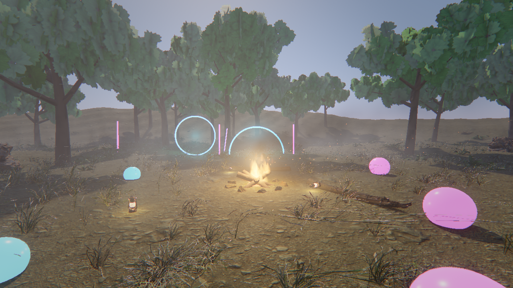
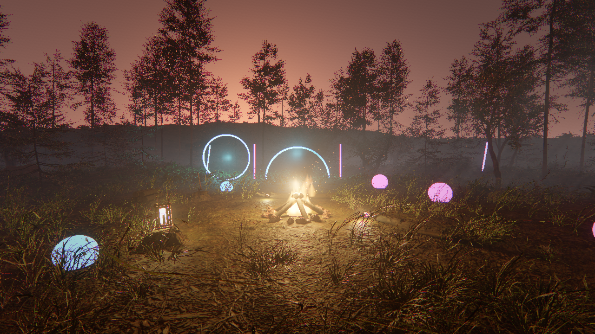
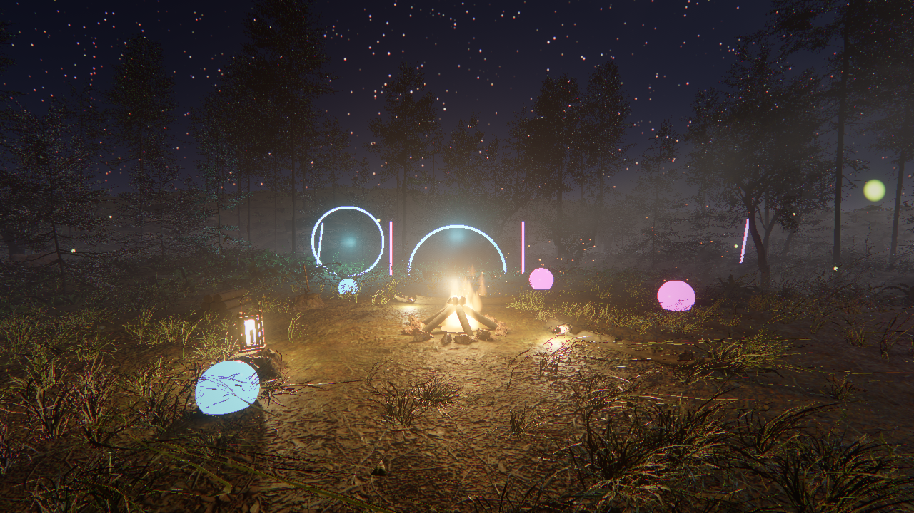

# Tech Demo Project

`samples/techdemo` is a first-person walk through a clearing in a fir forest that turns from day to night:
firs, grass and ferns bend in the wind, the low sun shines through the trunks at dusk, fireflies come out,
a campfire crackles and lights the trees, neon hoops hum, and glowing orbs roll when you push them. It brings
together the [SkyAtmosphere](../rendering.md#day-and-night), [Wind](../rendering.md#wind),
[GPU particles](../particles.md#gpu-simulation), physics, audio and [mouse look](../actions.md#mouse-look).







## Running it

The trees, plants, rocks, dead wood, props and the forest floor are CC0 assets from Poly Haven. They are not
in the repository: download them first (about 900 MB, once), then open the project:

```bash
python samples/techdemo/tools/fetch_assets.py
illusion_editor --project samples/techdemo
```

Build the module with **Modules → Build Modules** and press **Play**. Click the Game view to capture the
mouse (Shift+F1 frees it).

| Action | Keyboard and mouse | Gamepad |
| --- | --- | --- |
| Look | mouse | right stick |
| Walk | W A S D | left stick |
| Run | Shift | left stick button |
| Jump | Space | South (A, Cross) |
| Speed up time (×20) | T | North (Y, Triangle) |

A full day lasts six minutes.

## What is in it

- **Terrain**: a flat clearing in a bowl of hills, with a triangle-mesh collider, covered with the Poly Haven
  needle litter of a pine forest.
- **Forest**: 110 tall firs (13 to 19 m), 80 young firs, 14 broad-leaved trees and 36 saplings, all Poly Haven
  models with a cylinder collider each. Every part of a tree shares one `windSway`, matched to its height, so
  trunks and needles bend together; leaves and needles also flutter (`windFlutter`).
- **Undergrowth**: about 14,000 grass tufts, ferns, bushes, nettles, flowers (celandine, dandelion,
  periwinkle), weeds, roots, dry branches and bark, scattered with a fixed seed. The undergrowth is thinner on
  the hills, which are only seen from afar.
- **Rocks and dead wood**: rock faces on the hills, boulders, mossy rocks, fallen logs, stumps and root
  clusters, solid through convex-hull colliders.
- **Sky**: a `SkyAtmosphere` whose time the module advances; the sun sets behind the neon gate, lights the
  day and casts the shadows, the moon the night. `VolumetricFog` turns its light into shafts between the trunks.
- **Campfire**: logs leaning over the embers in a ring of stones, flame, ember and smoke emitters (the embers
  and smoke drift downwind), a flickering point light that dances with the flames and casts soft, moving
  [shadows](../rendering.md#point-light-shadows), and a looping crackle. Two fallen trunks and a stump to
  sit on, a woodpile and an axe in a stump.
- **Night**: 5,000 GPU fireflies, three lanterns that brighten at dusk and cast shadows, crickets.
- **Neon**: a gate, three hoops and bars in cyan, magenta and violet, with HDR emission that blooms.
- **Physics**: the orbs and lanterns are dynamic bodies the player pushes. They stay kinematic until the
  terrain's collider is ready, so they do not fall through it while it is cooked.

### Lighter trees

The Poly Haven trees are made for close-ups: one fir has four million needle triangles. `fetch_assets.py`
therefore writes lighter copies of them (`*_lite.gltf`) next to the downloads. Needles and leaves are cards
that share no vertices with each other, so the script keeps an evenly spread part of the cards and enlarges
each one about its centre to make up for the leaf area it drops; trunks and branches stay as they are. The
engine's [levels of detail](../rendering.md#levels-of-detail) thin these cards further with distance; firs
on the hills, which the player never comes close to, have a `lodBias` of 2 so that they thin out sooner, and
only the trees near the clearing cast needle shadows. The script also bakes the models' texture transforms
(`KHR_texture_transform`) into their UVs.

With all of this, a night frame at 1280 × 720, with the shadows of the fire and the three lanterns, costs
about 30 ms on the GPU of a desktop RTX 4070 SUPER (shadows 12 ms, depth 6 ms, shading 11 ms).

## How it is built

Everything but the Poly Haven files is made by scripts with fixed seeds:

- `tools/fetch_assets.py` downloads the pinned Poly Haven files (size and SHA-256 checked), merges each plant's
  colour and alpha maps into RGBA leaf textures and writes the lighter trees.
- `tools/make_assets.py` writes the terrain, neon, logs, the sprites and the sounds, and provides
  `terrain_height()`.
- `tools/make_scene.py` writes `build.jsonl`, the editor commands that create the materials and the scene,
  placing everything on the ground with `terrain_height()`.
- `modules/techdemo` is the game module: walking, looking, the clock, night effects, flickering lights.

To change the scene, edit a script and rebuild:

```bash
python samples/techdemo/tools/make_assets.py
python samples/techdemo/tools/make_scene.py
illusion_ctl --launch illusion_editor --editor-arg --headless --editor-arg --no-gpu --editor-arg --deterministic --editor-arg --project --editor-arg samples/techdemo replay samples/techdemo/build.jsonl
```

`tools/test_tools.py` tests the scripts; CI runs it.
